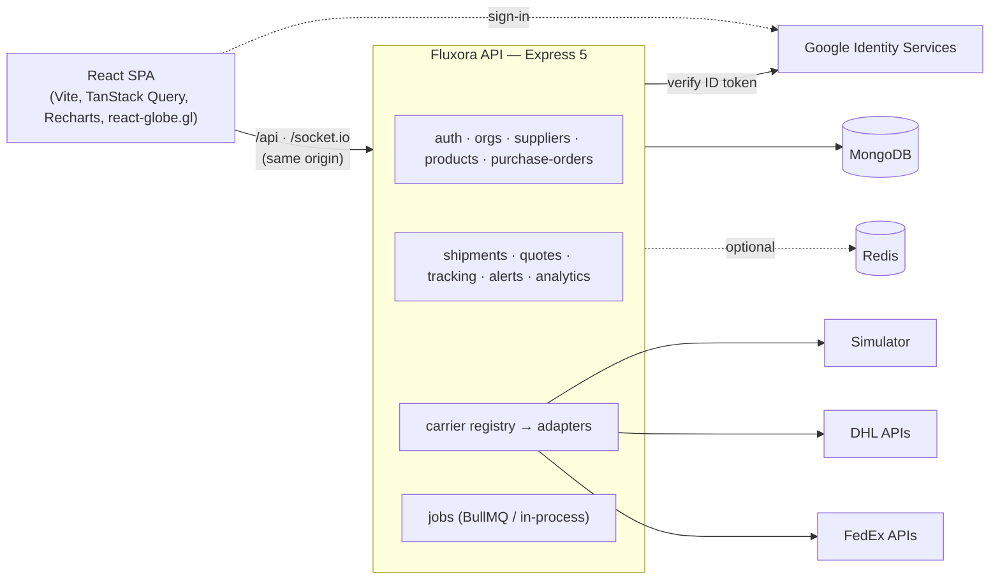

# Fluxora — Smart Logistics & Shipment Intelligence

Fluxora helps small and mid-sized businesses **compare carriers with explainable scoring, book and track shipments, catch exceptions early, manage purchase orders, and analyse freight spend** — in one operations console with a live 3D globe, light and dark themes, and strict data-provenance labelling.

> **Data honesty first.** Every price, booking and tracking event is labelled with where it came from: `LIVE_QUOTE`, `CONTRACT_RATE`, `SANDBOX_QUOTE`, `ESTIMATED` or `SIMULATED`. Without carrier credentials, Fluxora uses a clearly labelled simulator — it never presents demo data as a carrier offer.

---

## Contents

1. [Features](#features)
2. [Architecture](#architecture) · [Tech stack](#tech-stack) · [Repository structure](#repository-structure)
3. [Getting started](#getting-started) (prerequisites, install, run, seed)
4. [Configuration](#configuration) (environment, Google sign-in, MongoDB, Redis, carriers)
5. [Real APIs vs. simulation](#real-apis-vs-simulation) · [Data provenance labels](#data-provenance-labels)
6. [Recommendation algorithm](#recommendation-algorithm)
7. [Exception detection](#exception-detection) · [Analytics metric definitions](#analytics-metric-definitions)
8. [Testing](#testing) · [Deployment](#deployment)
9. [Security](#security) · [Known limitations](#known-limitations) · [Future improvements](#future-improvements) · [Troubleshooting](#troubleshooting)

More detail: [`docs/ARCHITECTURE.md`](docs/ARCHITECTURE.md) · [`docs/DATA_MODEL.md`](docs/DATA_MODEL.md) · [`docs/API.md`](docs/API.md)

---

**Live demo:** https://fluxora-yeyl.onrender.com · step-by-step walkthrough in [docs/DEMO_GUIDE.md](docs/DEMO_GUIDE.md).

## Features

| Module | What it does |
| --- | --- |
| **A. Smart carrier comparison** | Route, cargo, deadline, service level, budget, insurance and special-handling inputs. Volumetric and billable weight (configurable divisor). Parallel quotes from DHL, FedEx, UPS, DSV, Kuehne+Nagel and CEVA via a provider-independent adapter layer, with per-provider timeouts and failure isolation. Hard-constraint eligibility, then **Cheapest / Fastest / Best balanced** ranking with adjustable weights, per-offer explanations, trade-offs, price breakdowns and provenance. |
| **B. Shipment management** | Draft → Quoted → Booked → Picked up → In transit → Out for delivery → Delivered (+ Delayed, Exception, Cancelled) with server-enforced transitions. Search, filter, sort and paginate. **Idempotent booking** (`Idempotency-Key` + atomic lock), simulated or manual bookings, cancellation only where supported. Append-only event history. |
| **C. Tracking & exception alerts** | Normalised tracking events from the DHL Unified Tracking API, FedEx Track API (when configured) or the simulator, deduplicated and pushed live over **Socket.IO** (organisation-scoped rooms). Rule-based alerts for stuck statuses, missed delivery dates, carrier-reported delays/exceptions and silent tracking — deduplicated, acknowledgeable, resolvable and auto-resolved when cleared. Background jobs via BullMQ (Redis) or an in-process scheduler. |
| **D. Purchase orders (lightweight ERP)** | Suppliers and a product catalogue; POs with dynamic lines, server-calculated totals in integer minor units, Draft → Approved (admin) → Ready to ship → Partially received → Received / Cancelled; line-level receiving with validation; "Create shipment" pre-filled from the supplier and PO; linked records in both directions; activity history. |
| **E. Logistics analytics** | Aggregation-pipeline metrics with disclosed denominators: totals, in transit, delivered, delayed/exception, spend per currency (never mixed), monthly trend, average transit, on-time rate, carrier cost and performance, PO totals and open commitments, and **hypothetical** savings. Date, carrier, shipment-status and PO-status filters. |
| **UI** | B2B ops console with an interactive 3D globe (shipment lanes as animated arcs, exception rings, HUD telemetry), collapsible sidebar, mobile drawer, notifications, light / dark / system themes, skeletons, empty and error states, toasts, confirmation dialogs, accessible forms and keyboard navigation. |
| **Auth & tenancy** | Google Identity Services sign-in verified server-side, HttpOnly session cookies, CSRF tokens, organisations with Admin/Member roles, invites, organisation switching, and strict tenant isolation (also on WebSockets). |

## Architecture

A **TypeScript modular monolith**: one Express 5 API (REST + Socket.IO + background jobs) and one React SPA. See [`docs/ARCHITECTURE.md`](docs/ARCHITECTURE.md) for the full diagrams, booking sequence, tracking pipeline and design decisions.



## Tech stack

| Layer | Choices |
| --- | --- |
| Frontend | React 19, TypeScript, Vite 8, React Router 8, Tailwind CSS 4, TanStack Query 5, React Hook Form + Zod 4, Recharts 3, react-globe.gl / three.js, Socket.IO client, Lucide icons, Sonner toasts |
| Backend | Node.js ≥ 20.19 (22 recommended), TypeScript 6, Express 5, Mongoose 9 (MongoDB 7+/8), Zod 4, Socket.IO 4, express-session + connect-mongo, google-auth-library, helmet, express-rate-limit (+ rate-limit-redis), ioredis + BullMQ (optional), pino |
| Testing | Vitest, Supertest, mongodb-memory-server, React Testing Library, Playwright |
| Ops | Docker multi-stage images, nginx (SPA + reverse proxy), Docker Compose (MongoDB, Redis, API, web) |

## Repository structure

```
fluxora/
├── client/                    React SPA
│   ├── src/
│   │   ├── app.tsx            routes, providers, auth guard
│   │   ├── components/        ui/ (design system), layout/, globe/, charts
│   │   ├── features/          dashboard, shipments, compare, tracking, purchase-orders,
│   │   │                      suppliers, products, analytics, settings, auth
│   │   ├── lib/               api client, formatting, types, constants, geo
│   │   └── providers/         theme, auth, Google button, realtime (Socket.IO)
│   ├── e2e/                   Playwright smoke tests
│   ├── Dockerfile · nginx.conf
├── server/                    Express API
│   ├── src/                   see docs/ARCHITECTURE.md → module layout
│   ├── tests/unit · tests/integration
│   └── Dockerfile
├── docs/                      ARCHITECTURE.md · DATA_MODEL.md · API.md
├── docker-compose.yml · .env.example · package.json (npm workspaces)
```

## Getting started

### Prerequisites

* **Node.js 22** (≥ 20.19) and npm 10
* **MongoDB 7 or 8** running locally (`mongodb://127.0.0.1:27017`) or a hosted cluster (e.g. MongoDB Atlas)
* Optional: **Redis 7** · **Docker** (for the containerised stack) · a **Google OAuth client ID**

### Install & run (local development)

```bash
git clone <repo> fluxora && cd fluxora
npm install                                   # installs both workspaces
cp .env.example server/.env                   # then edit — at minimum SESSION_SECRET
node -e "console.log(require('crypto').randomBytes(48).toString('base64url'))"   # → SESSION_SECRET
npm run seed -- you@example.com               # sample workspace, with you as admin
npm run dev                                   # API :4100 + web :5180 (Vite proxies /api and /socket.io)
```

Open **http://localhost:5180** and sign in with Google (email sign-in links appear only when `RESEND_API_KEY` is set, which needs a verified domain). You land in the sample workspace:

| Workspace | Scenario | Fictional team members |
| --- | --- | --- |
| Shahi Exports (Demo) | An apparel manufacturer with factories in Faridabad and Bengaluru: fabric, yarn and trims arrive from suppliers in China, Bangladesh, Turkey, Italy, Vietnam and India against purchase orders, and finished garments ship to buyers in Los Angeles, Hamburg and London | `ananya.rao@shahi-demo.test` (admin), `vikram.singh@shahi-demo.test` (member — cannot approve POs or change settings) |

With `DEMO_ORG_SLUG=demo-shahi` (set in `render.yaml` for the live site) everyone who signs in also joins this workspace as a member and lands in it on their first visit; members there see only the fictional team and themselves. Only the workspace name refers to a real company and it keeps "(Demo)" in its name; suppliers, buyers, people, addresses and figures are invented (disclosed on the Privacy page). The fictional members are ordinary users (the browser tests sign in as them to check roles).

Run the two halves separately with `npm run dev -w server` and `npm run dev -w client`. The default ports are **4100** (API) and **5180** (web); change them with `PORT` and `CLIENT_URL` (and `VITE_DEV_API_PROXY` for the client).

### Seed data

`npm run seed` is **repeatable**: it deletes and recreates only organisations whose slug starts with `demo-` and the fictional users it created (flagged `isDemoUser`); your own account is kept. It creates 8 fictional suppliers, 8 raw-material and trim products, 8 purchase orders across every status (USD, EUR and INR), ~57 inbound and outbound shipments (eight months of delivered history plus active shipments in every operational state), simulated quotes and tracking histories, and alerts from the real rule engine. Seeded records are flagged `isDemo` internally; in the UI, simulator prices, bookings and tracking carry a small **Sample** tag. Active simulated shipments keep progressing in real time via the tracking job; **Simulate next event** releases the next milestone immediately.

## Configuration

All variables are documented in [`.env.example`](.env.example) and validated at startup (the server exits with a clear message listing invalid or missing variables). The server reads `server/.env`, falling back to a repository-root `.env` (used by Docker Compose).

| Group | Variables |
| --- | --- |
| **Required** | `MONGODB_URI`, `SESSION_SECRET` (≥ 32 chars), `CLIENT_URL` |
| Server | `NODE_ENV`, `PORT`, `SERVER_URL`, `CORS_ORIGIN` (comma-separated allowlist, defaults to `CLIENT_URL`), `TRUST_PROXY`, `LOG_LEVEL` |
| Sessions | `SESSION_TTL_HOURS`, `COOKIE_SAMESITE` (`lax` \| `strict` \| `none`), `COOKIE_SECURE` (`none` requires `true`) |
| Auth | `GOOGLE_CLIENT_ID`; email sign-in links: `RESEND_API_KEY`, `EMAIL_FROM` (without a key, only Google sign-in is offered) |
| Redis (optional) | `REDIS_URL` |
| Quotes & jobs | `QUOTE_CACHE_TTL_SECONDS`, `CARRIER_TIMEOUT_MS`, `CARRIER_SIMULATION_ENABLED`, `JOBS_ENABLED`, `EXCEPTION_SCAN_INTERVAL_SECONDS`, `TRACKING_POLL_INTERVAL_SECONDS`, `RATE_LIMIT_WINDOW_SECONDS`, `RATE_LIMIT_MAX` |
| Carriers (optional) | `DHL_TRACKING_API_KEY`, `DHL_TRACKING_BASE_URL`, `DHL_EXPRESS_USERNAME/PASSWORD/ACCOUNT_NUMBER/BASE_URL`, `FEDEX_CLIENT_ID/CLIENT_SECRET/ACCOUNT_NUMBER/BASE_URL`, `UPS_CLIENT_ID/CLIENT_SECRET/ACCOUNT_NUMBER/BASE_URL`, `DSV_USERNAME/PASSWORD/TOKEN_SUBSCRIPTION_KEY/TRACKING_SUBSCRIPTION_KEY/BASE_URL`; reserved (no adapter yet): `KN_CLIENT_ID/SECRET`, `CEVA_API_KEY` |
| Client (build-time) | `VITE_API_URL` (empty = same origin), `VITE_DEV_API_PROXY` (dev proxy target) |

### Google authentication setup

1. In [Google Cloud Console](https://console.cloud.google.com/apis/credentials) create an **OAuth 2.0 Client ID** of type **Web application**.
2. Add **Authorized JavaScript origins**: `http://localhost:5180` (dev), `http://localhost:8080` (Docker) and your production origin. No redirect URI is needed — Fluxora uses the Google Identity Services popup / ID-token flow.
3. Set `GOOGLE_CLIENT_ID=<id>.apps.googleusercontent.com` in `server/.env` and restart. The client reads the ID from `GET /api/v1/auth/config`, so nothing needs rebuilding.
4. **How it works:** the browser receives an ID token (JWT) from Google and posts it to `POST /auth/google`. The server verifies it with `google-auth-library` (RS256 signature against Google's certs, audience = your client ID, issuer `accounts.google.com`, expiry, `email_verified`), then creates or links the user, accepts pending invites, regenerates the session id and returns a new CSRF token. No client secret is required for this flow, and the client is never trusted to assert identity.
5. **Audience:** a new External app starts in **Testing** mode — only accounts listed under *Google Auth Platform → Audience → Test users* can sign in (up to 100). Add teammates there, or publish the app (Google may require verification) to open sign-in to any Google account.
6. A first-time user gets a personal workspace as Admin. Admins invite colleagues by email under **Settings → Members**; invitees join at their first Google sign-in (in Testing mode they must also be Google test users).

### MongoDB

Any MongoDB 7+ deployment works (standalone is fine — no transactions are required). Indexes are created automatically at startup (`autoIndex`) and by the seed script. For Atlas, set `MONGODB_URI=mongodb+srv://…/fluxora` and allow your server's IP. Sessions are stored in the `sessions` collection with a TTL index.

### Redis (optional)

Set `REDIS_URL=redis://localhost:6379` to enable:

* a **shared quote cache** (keys include the organisation, provider, carrier and a hash of every price-affecting input; never cached beyond a quote's `validUntil`; original `retrievedAt` preserved and flagged `fromCache`),
* **distributed rate limiting** (`rate-limit-redis`),
* **BullMQ** job scheduling for `tracking-poll` and `exception-scan` (deduplicated across instances; 3 attempts with exponential backoff).

Without Redis, Fluxora logs a warning and uses an in-memory cache, in-memory rate limiting and in-process interval jobs (with an overlap guard). That is fine for local development or a **single instance**; use Redis when running more than one API instance. If Redis is configured but unreachable at startup, the server falls back to in-memory mode and says so.

### Carrier API configuration

See the **Settings → Carrier integrations** page (or `GET /api/v1/health/ready`) for live status.

| Carrier | Capability | How to enable | Status in this repository |
| --- | --- | --- | --- |
| DHL | **Tracking** — [Shipment Tracking – Unified API](https://developer.dhl.com/api-reference/shipment-tracking) (`GET /track/shipments`, header `DHL-API-Key`) | Create an app at developer.dhl.com and set `DHL_TRACKING_API_KEY`. (`demo-key` returns mocked responses and is labelled as sandbox.) | Implemented; unit-tested with mocked HTTP. Not exercised against a live key here. Free keys are rate-limited (documented as 250 calls/day) — Fluxora polls each live shipment at most every 30 min. |
| DHL | **Rates** — MyDHL Express API `GET /rates` (Basic auth) | `DHL_EXPRESS_USERNAME`, `DHL_EXPRESS_PASSWORD`, `DHL_EXPRESS_ACCOUNT_NUMBER`; `DHL_EXPRESS_BASE_URL` ends in `/test` for the sandbox | Implemented from the published reference; mocked tests only; **not verified with live credentials**. Rated as a single piece (noted in each quote's limitations). |
| FedEx | **Rates + tracking** — OAuth `/oauth/token`, `/rate/v1/rates/quotes`, `/track/v1/trackingnumbers` | `FEDEX_CLIENT_ID`, `FEDEX_CLIENT_SECRET`, `FEDEX_ACCOUNT_NUMBER`, `FEDEX_BASE_URL` (`https://apis-sandbox.fedex.com` or `https://apis.fedex.com`) | Implemented; token cached; mocked tests only; **not verified with live credentials**. |
| UPS | **Rates + tracking** — OAuth `/security/v1/oauth/token`, `/api/rating/v2409/Shoptimeintransit`, `/api/track/v1/details/{n}` | `UPS_CLIENT_ID`, `UPS_CLIENT_SECRET`, `UPS_ACCOUNT_NUMBER`, `UPS_BASE_URL` (`https://wwwcie.ups.com` or `https://onlinetools.ups.com`) | Implemented from UPS's OpenAPI specs; mocked tests only; **not verified with live credentials**. Rates need a UPS shipping account. |
| DSV | **Tracking** — Generic Tracking API v2 (`/oauth/v1/token`, `/tracking/v2/shipments/bookingId/{id}`) | Register on [developer.dsv.com](https://developer.dsv.com/), subscribe to "DSV Access Token" and "Tracking", set `DSV_USERNAME/PASSWORD`, `DSV_TOKEN_SUBSCRIPTION_KEY`, `DSV_TRACKING_SUBSCRIPTION_KEY`. The tracking number is the DSV booking ID. | Implemented against the **demo environment** (test shipments, labelled sandbox). Quotes simulated — the DSV Quote API is asynchronous. Production needs a DSV customer account. |
| Kuehne+Nagel | Rates, booking, tracking | myKN account + API portal OAuth keys ([portal.api.kuehne-nagel.com](https://portal.api.kuehne-nagel.com/)), product enablement by K+N | **No adapter** — requires partner onboarding. Simulated. |
| CEVA | — | No public self-service developer portal was found; access is arranged with CEVA | **No adapter.** Simulated. |
| All | **Booking via API** | — | Not implemented for real carriers (each requires an account and carrier-specific label/booking flows). Book with the carrier directly and use **Record manual booking**; if the carrier's tracking API is configured, the tracking number then switches the shipment to live tracking. |

**Adding a real adapter:** implement `CarrierAdapter` (`server/src/integrations/carriers/types.ts`), map responses to `NormalizedQuote` / `NormalizedTrackingEvent` with an honest `provenance`, register it in `server/src/modules/carriers/carrier.registry.ts` behind its credentials, and add mocked-HTTP tests.

## Real APIs vs. simulation

| Feature | Real when… | Otherwise |
| --- | --- | --- |
| Carrier quotes | DHL Express / FedEx credentials are set (sandbox → `SANDBOX_QUOTE`; FedEx account rates → `CONTRACT_RATE`; production → `LIVE_QUOTE`) | **Simulator** (`SIMULATED`). Illustrative profiles, not carrier tariffs; deterministic per request; valid for 30 minutes. |
| Booking | Never via a real carrier API in this version | Simulated booking (`SIM-BK-…` reference, `SIM…` tracking number) for simulated offers; **manual booking** records for real ones. |
| Tracking | DHL tracking key / FedEx credentials + a real tracking number | Simulated journey (scripted milestones, ~70% on time / ~20% delayed / ~10% customs exception, daily position pings) or manual updates. |
| Reliability | Always real: computed from **your own** delivered shipments (seeded history is labelled demo data) | "Unavailable" below the minimum sample size; excluded from scoring. |
| Exchange rates | Not configured | Currencies are never converted or mixed; analytics report per currency. |

## Data provenance labels

| Label | Meaning |
| --- | --- |
| `LIVE_QUOTE` | Returned by the carrier's production API. |
| `CONTRACT_RATE` | Account-specific rate returned by the carrier API. |
| `SANDBOX_QUOTE` | From the carrier's test environment — not a bookable offer. |
| `ESTIMATED` | Calculated by Fluxora, not provided by a carrier (reserved; not currently produced). |
| `SIMULATED` | Generated by Fluxora's simulator — never a carrier offer. Shown in the UI as a grey **Sample rate** / **Sample tracking** tag with an explanatory tooltip. |

Every quote also carries `provider`, `retrievedAt` (preserved when served from cache), `validUntil`, `fromCache` and `limitations[]`. Tracking events carry `source.type` (`CARRIER_API` · `SIMULATED` · `USER` · `SYSTEM`), `provider` and a sandbox flag.

## Recommendation algorithm

Implemented in [`server/src/modules/quotes/recommendation.ts`](server/src/modules/quotes/recommendation.ts) (pure, deterministic, unit-tested).

1. **Hard constraints first** ([`eligibility.ts`](server/src/modules/carriers/eligibility.ts)): service level matches the preference (if set); shipment type; per-package and total weight; longest side; special-handling support; estimated delivery ≤ required date (end of day, UTC); price ≤ budget (same currency only — otherwise flagged, never converted); quote not expired. Ineligible offers are shown separately with their reasons.
2. **Group by currency.** Prices in different currencies are never compared; each currency is ranked separately.
3. **Normalise to 0–1 (higher = better):** cost `(max − price) / (max − min)`; transit `(maxDays − days) / (maxDays − minDays)` (1 when all equal); reliability = the carrier's on-time rate from your history.
4. **Missing-metric policy:** a metric is used only if it is available for **every** offer in the group. Otherwise it is excluded for the group and the remaining weights are renormalised — a missing value is never treated as perfect (or as zero). The UI states which metric was excluded and why.
5. **Score** = 100 × Σ (wᵢ / Σ included w) × metricᵢ. Default weights: cost 50, transit 30, reliability 20 (organisation-configurable, adjustable per comparison with immediate server-side re-ranking).
6. **Deterministic ties:** price, then transit days, then carrier code, service name, id.
7. **Explanations:** cheapest / fastest / best-balanced badges, the score split per metric, the difference to the cheapest and fastest options, reliability with sample size, and trade-off sentences ("costs $X more but arrives N days sooner").

## Exception detection

Pure rules in [`exception-rules.ts`](server/src/modules/alerts/exception-rules.ts), thresholds configurable per organisation (**Settings → Alert rules**):

| Rule | Fires when | Severity |
| --- | --- | --- |
| `CARRIER_EXCEPTION` | Status is `DELAYED` or `EXCEPTION` (reported by the provider or recorded manually) | Medium / High |
| `STUCK_IN_STATUS` | Time in the current status exceeds its threshold (defaults: booked 72 h, picked up 48 h, in transit 168 h, out for delivery 24 h, delayed 72 h, exception 24 h) | Medium; High above 2× |
| `PAST_EXPECTED_DELIVERY` | Now is past the end of the expected delivery day (+ grace) and not delivered | Medium → High (>24 h) → Critical (>72 h) |
| `TRACKING_STALE` | No tracking update for `trackingStaleHours` (default 36) on automatically tracked in-flight shipments | Low; High above 2× |

Rules run on every new tracking event and on a schedule. Alerts are unique per unresolved occurrence, carry a recommended next action, can be acknowledged and resolved (with a note), are auto-resolved when the condition clears, and are pushed to connected users.

## Analytics metric definitions

* **Shipments in period** — created within the date range (status/carrier filters applied).
* **Freight expenditure** — Σ recorded freight cost of shipments **booked** in the period, excluding cancelled; reported **per currency**.
* **On-time delivery rate** — delivered on or before the end of the expected delivery day (UTC) ÷ delivered shipments with both dates; the denominator is shown as `n`.
* **Average transit time** — mean (delivered − picked up) for shipments delivered in the period with both timestamps; `n` shown.
* **Carrier performance** — the same metrics per carrier, plus shipments that had a delay or exception event.
* **Potential savings (hypothetical)** — for booked shipments chosen from a comparison: selected price − cheapest eligible offer in the same comparison and currency (if positive). **Not realised savings.**
* Seeded and simulated data are disclosed on the dashboard and analytics pages.

## Testing

```bash
npm test                    # server unit + integration (Vitest, Supertest, in-memory MongoDB) and client component tests
npm run test -w server      # 100 tests: money, billable weight, eligibility, recommendation, rules, cache, adapters (mocked HTTP),
                            #            auth, CSRF, sessions, tenancy, sockets, ERP, shipments, booking idempotency, alerts, analytics
npm run test -w client      # 22 tests: PO create/approve, create shipment from PO, quote comparison, tracking timeline, empty/error states,
                            #           double-submit guard, sign-out, error messages
npm run typecheck && npm run lint

# End-to-end smoke tests (Playwright) against a running, seeded stack:
npm run seed && npm run dev                     # terminal 1 (tests sign in via email-link tokens in MongoDB)
npx playwright install chromium                 # once
npm run test:e2e -w client                      # terminal 2 — 5 browser flows
```

Server tests use **mongodb-memory-server** (it reuses a local `mongod` binary when present; otherwise it downloads one). Carrier APIs are always mocked — tests never call paid or live services.

## Deployment

**Render + MongoDB Atlas (free tiers):** `render.yaml` is a Render Blueprint for one web service that runs the API and serves the built web app on the same origin (in production `server/src/app.ts` serves `client/dist`).

1. Create a free MongoDB Atlas M0 cluster and a database user, allow network access from `0.0.0.0/0` (Render's free plan has no fixed outbound IPs), and copy the connection string ending in `/fluxora`.
2. In Render: **New → Blueprint**, pick this repository, then fill the prompted secrets (`MONGODB_URI`, optional carrier keys). `SESSION_SECRET` is generated by Render.
3. Add the service URL (this deployment: `https://fluxora-yeyl.onrender.com`) to the Google OAuth client's authorised JavaScript origins, and set `CLIENT_URL` if Render assigned a different name.
4. Optional sample data on the live database: `MONGODB_URI='<atlas uri>' npm run seed -- you@example.com`.

GitHub Actions (`.github/workflows/ci.yml`) runs type checks, lint, tests and the build on every push; Render deploys only after they pass. On the free plan the service sleeps after ~15 minutes without traffic (the next visit takes ~50 s, and background tracking polls pause while asleep). Without `RESEND_API_KEY`, production offers Google sign-in only.

**Docker Compose (all-in-one):**

```bash
cp .env.example .env          # set SESSION_SECRET (+ GOOGLE_CLIENT_ID); see the note on NODE_ENV in docker-compose.yml
docker compose up --build     # web on http://localhost:8080 (nginx → API, MongoDB and Redis on the internal network)
docker compose exec server node dist/scripts/seed.js     # optional demo data
```

**Separate hosting:**

* **API** — any Node 22 host (Render, Fly.io, Railway, ECS, a VM). `npm ci && npm run build -w server && node server/dist/server.js` (or `server/Dockerfile`). Health checks: `GET /api/v1/health` (liveness) and `/api/v1/health/ready` (readiness). Handles `SIGTERM` gracefully (stops jobs, closes sockets, HTTP, Redis and MongoDB).
* **Web** — `npm run build -w client` produces static files in `client/dist`. Serve them behind the same origin as the API (recommended, see `client/nginx.conf`), or on a separate origin with `VITE_API_URL=https://api.example.com` at build time plus API settings `CORS_ORIGIN=https://app.example.com`, `COOKIE_SAMESITE=none`, `COOKIE_SECURE=true` and `TRUST_PROXY=1`.
* **Production checklist:** `NODE_ENV=production`, a strong `SESSION_SECRET`, `COOKIE_SECURE=true` (HTTPS), `RESEND_API_KEY` and a verified `EMAIL_FROM` domain for email sign-in, `GOOGLE_CLIENT_ID` set with your production origin authorised, `REDIS_URL` for more than one instance, managed MongoDB with backups.

> No deployment was performed as part of building this repository. The Compose stack was built and run locally (Docker 28): all four services became healthy, the containerised seed ran, and sign-in, live Socket.IO updates through nginx, the Redis quote cache, Redis rate limits and BullMQ jobs were verified at http://localhost:8080.

## Security

* Google ID tokens are verified server-side; the client cannot assert an identity. Session ids rotate at sign-in; sign-out destroys the server session.
* HttpOnly, `SameSite` session cookies (`Secure` in production); synchronizer-token CSRF protection on every state-changing request; strict CORS allowlist.
* Membership and role are re-checked on every request and socket connection; all queries are organisation-scoped; admin-only actions enforced in the API.
* Zod validation of params, query and body; allowlisted sort fields; `simple` query parser and body key sanitisation against NoSQL operator injection; escaped regex search; 200 kB body limit.
* helmet security headers, rate limiting (stricter on sign-in and quote fan-out), pino log redaction of cookies, tokens and secrets, generic 500 messages in production, request ids in every error.
* Secrets only come from environment variables; `.env` files are git-ignored; carrier credentials never reach the browser. `npm audit` reports 0 known vulnerabilities at the time of writing.

## Known limitations

* No real carrier booking APIs; Kuehne+Nagel and CEVA have no adapters (partner onboarding required); DSV has tracking only, against DSV's demo environment. DHL, FedEx and UPS adapters are implemented from public documentation but **not verified against live credentials**.
* Simulated prices and transit times are illustrative only. Simulated multi-currency prices use fixed illustrative factors, not FX rates.
* All packages in a shipment are assumed to share the same dimensions; billable weight uses one divisor per service (real carriers have more rules: rounding, minimums, loading metres, oversize fees).
* No currency conversion; analytics are per currency.
* Over-receipt of purchase orders is not permitted (no exception workflow yet); no partial PO cancellation; single-level approval.
* Without Redis, caches, rate limits and jobs are per-process (fine for one instance only).
* The 3D globe needs WebGL (a text fallback is shown otherwise) and adds a ~2 MB lazy-loaded chunk. City coordinates come from a small built-in table (unknown cities fall back to the country centroid).

## Future improvements

Real booking/label APIs (DHL MyDHL shipments, FedEx Ship, UPS Shipping), DSV quotes and K+N adapters once onboarded, webhook-based tracking, an FX-rate source with explicit conversion provenance, multi-piece package lists, document uploads (commercial invoice, POD), email/Slack notifications for alerts, configurable approval thresholds, partial cancellation and over-receipt workflows, CSV export, OpenAPI spec generation, and SSO beyond Google.

## Troubleshooting

| Symptom | Fix |
| --- | --- |
| Server exits with "Invalid environment configuration" | It lists the variables — usually `SESSION_SECRET` is missing or shorter than 32 characters, or `MONGODB_URI` is unset. |
| `MongoServerSelectionError` / `ECONNREFUSED 27017` | Start MongoDB (`brew services start mongodb-community`, `docker run -p 27017:27017 mongo:8`) or fix `MONGODB_URI`. |
| `EADDRINUSE :4100` or Vite "port 5180 is in use" | Another process is using the port: change `PORT` (and `VITE_DEV_API_PROXY`) or the Vite port, and update `CLIENT_URL`. |
| Google button missing / "Google sign-in is not configured" | Set `GOOGLE_CLIENT_ID` in `server/.env` and restart the API. |
| Google popup error "origin not allowed" / `idpiframe_initialization_failed` | Add the exact origin (scheme, host and port) to **Authorized JavaScript origins**; it can take a few minutes to propagate. |
| Sign-in succeeds but every request returns 401 | The session cookie isn't sent back: use the Vite proxy / same origin, or for cross-origin set `COOKIE_SAMESITE=none`, `COOKIE_SECURE=true` (HTTPS) and `CORS_ORIGIN`. Behind a proxy set `TRUST_PROXY=1`. |
| `403 CSRF_INVALID` | The session expired or was rotated; reload the page (the client refreshes the token and retries once automatically). |
| No email option on the sign-in page | Expected without `RESEND_API_KEY`. To enable it, verify a domain in Resend, set `EMAIL_FROM` on that domain and add the key. |
| "Realtime offline" in the sidebar | The WebSocket can't reach `/socket.io`: check the Vite proxy / nginx `Upgrade` headers and that the API is running. |
| Globe area is blank | WebGL is disabled (e.g. some VMs or remote desktops) — enable hardware acceleration; the rest of the app works without it. |
| Tests hang downloading MongoDB | Install `mongod` locally or set `MONGOMS_SYSTEM_BINARY=/path/to/mongod`. |
| Redis errors in logs | Check `REDIS_URL`; Fluxora falls back to in-memory mode if Redis is unreachable at startup. |
