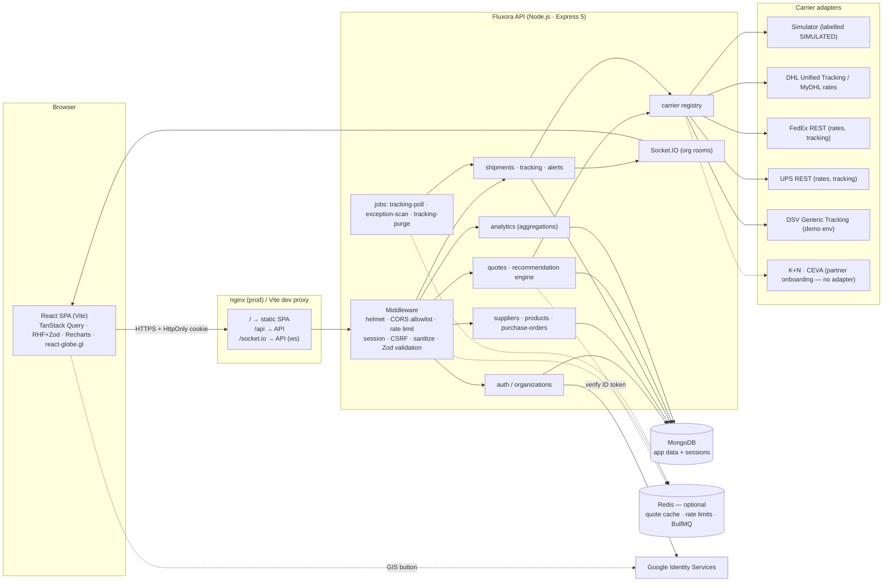
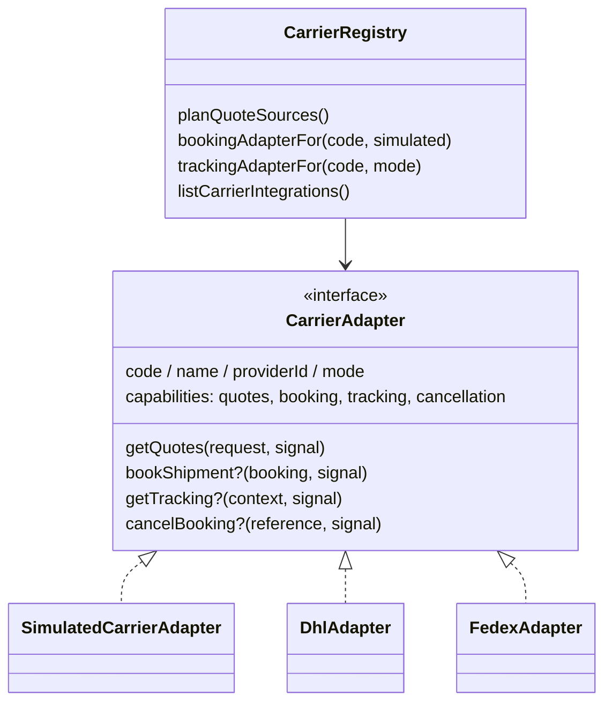
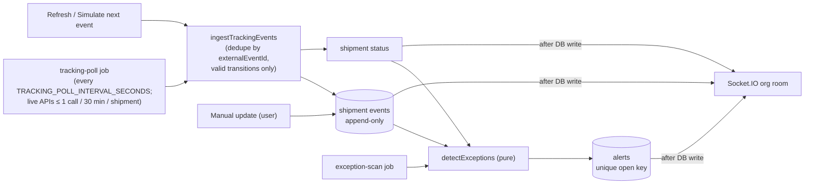

# Fluxora architecture

Fluxora is a **TypeScript modular monolith**: one Express API process (REST + Socket.IO + background jobs) and one React SPA. There are no microservices — modules are separated by folder and by service functions, not by network boundaries.

## System overview



## Request lifecycle

1. **Edge** — in production nginx serves the SPA and proxies `/api` and `/socket.io` to the API on the same origin (cookies stay `SameSite=Lax`, no CORS needed). In development Vite does the same.
2. **Global middleware** — request id, structured logging (pino, secrets redacted), `helmet`, CORS allowlist (`CORS_ORIGIN`), compression, 200 kB JSON limit, `simple` query parser (no nested objects → no operator injection via query strings).
3. **API router** — rate limiter (Redis store when configured), `express-session` (MongoDB store, HttpOnly cookie), body sanitiser (drops `$`/`.` keys), CSRF check for every non-GET request.
4. **Secured router** — `requireAuth` loads the user and **re-checks the membership on every request**, producing `req.auth = { userId, organizationId, role }`. `requireRole('ADMIN')` guards admin actions.
5. **Route handlers** — parse params/query/body with Zod, call a service, return `{ data, meta? }`. Every query includes `organizationId` from `req.auth` (never from the client).
6. **Errors** — `AppError` (and Mongoose / duplicate-key errors) are converted to `{ error: { code, message, details?, requestId } }`; stack traces are never returned in production.

## Module layout (server)

Every feature module uses the same files, so each one reads the same way:

| File | Responsibility |
| --- | --- |
| `x.model.ts` | Mongoose schema and indexes (the shape of the stored data) |
| `x.schemas.ts` | Zod schemas for request bodies and query strings (what the API accepts) |
| `x.service.ts` | Business logic and all database access; takes `organizationId` first, plus the acting user when it writes |
| `x.routes.ts` | Thin Express handlers: validate input → call the service → send `{ data, meta? }` |
| `x.rules.ts` (optional) | Pure functions with no database access (status transitions, calculations), unit tested |

```
server/src
├── app.ts / server.ts          app wiring, graceful shutdown
├── config/                     env validation (Zod), logger, Mongo, Redis
├── middleware/                 auth (requireAuth, requireRole, actorOf), csrf, sanitize, rate-limit, error handler
├── utils/                      money, pagination, validation helpers, dates, errors, counters, geo
├── modules/
│   ├── auth/                   Google ID-token verification, sessions, dev login
│   ├── organizations/          org settings, memberships, invites
│   ├── users/ audit/           user model, append-only audit log
│   ├── suppliers/ products/    ERP master data
│   ├── purchase-orders/        PO lifecycle, receiving (rules: transitions, receipt maths)
│   ├── shipments/              shipment lifecycle, idempotent booking (rules: statuses, transitions)
│   ├── carriers/               billable weight, eligibility (pure), adapter registry
│   ├── quotes/                 comparison orchestration, cache, recommendation engine (pure)
│   ├── tracking/               append-only events, ingestion, simulation controls
│   ├── alerts/                 exception rules (pure), alert lifecycle, scanner
│   └── analytics/              aggregation pipelines, reliability metric
├── integrations/carriers/      adapter contract + simulator, dhl, fedex, dsv, kuehne-nagel, ceva
├── jobs/                       BullMQ (with Redis) or in-process interval scheduler
├── sockets/                    Socket.IO auth + org rooms, realtime emitter
└── scripts/seed.ts             repeatable demo seed
```

Pure, unit-tested business logic lives in `*.rules.ts`, `billable-weight.ts`, `eligibility.ts`, `recommendation.ts`, `exception-rules.ts` and `utils/money.ts`. Shipment status groups (`PLANNING_STATUSES`, `TRACKABLE_STATUSES`, `OPEN_STATUSES`, `CANCELLABLE_STATUSES`) are named once in `shipment.rules.ts` and reused everywhere.

## Frontend layout (client)

Each feature folder (`client/src/features/<feature>`) holds its pages and dialogs plus a `hooks.ts` with the TanStack Query **read** hooks (`useShipments`, `useShipment`, …). **Writes** (`useMutation`) live in the component that triggers them, because that component owns the toast, dialog and navigation that follow. All query keys come from `lib/query-keys.ts`, so invalidation after a write or a realtime event always targets the right cache entries.

## Carrier integration architecture



* **Per-capability selection** — for each carrier, a configured live/sandbox adapter wins for the capabilities it implements; otherwise the simulator is used (if `CARRIER_SIMULATION_ENABLED`). DHL can therefore have *live tracking* and *simulated quotes* at the same time.
* **Isolation** — quotes are fetched with `Promise.all` over per-provider wrappers that never reject; each call gets `AbortSignal.timeout(CARRIER_TIMEOUT_MS)`. HTTP failures map to `TIMEOUT / RATE_LIMITED / AUTH / VALIDATION / UNAVAILABLE`, reported per provider in the response.
* **Normalisation** — every adapter returns `NormalizedQuote` / `NormalizedTrackingEvent` with a `provenance` block (`sourceType`, `provider`, `retrievedAt`, `isSimulated`, `validUntil`, `limitations`).

## Booking flow & idempotency

```mermaid
sequenceDiagram
  participant UI
  participant API
  participant DB as MongoDB
  participant C as Carrier adapter
  UI->>API: POST /shipments/:id/book (Idempotency-Key: K)
  API->>DB: find BookingRecord(org, K)
  alt already SUCCEEDED
    API-->>UI: 200 + stored shipment (Idempotent-Replayed: true)
  end
  API->>DB: insert BookingRecord(K, PENDING)  [unique index]
  API->>DB: findOneAndUpdate(shipment QUOTED & no lock → bookingLock=K)
  alt lock not acquired
    API-->>UI: 409 another booking in progress / already booked
  end
  API->>C: bookShipment(...)
  alt success
    API->>DB: status BOOKED, booking ref, tracking #, unlock; record SUCCEEDED; append BOOKED event
    API-->>UI: 201
  else failure
    API->>DB: unlock; record FAILED; append BOOKING_FAILED event (status stays QUOTED)
    API-->>UI: 502 with the provider's message
  end
```

## Tracking & exceptions



* Status transitions are enforced by `shipment.rules.ts`; events implying an invalid transition are still recorded (as `TRACKING`) with the ignored status in `metadata`.
* Alerts are de-duplicated by a **partial unique index** on `{ organizationId, openKey }` (`openKey` is set only while unresolved). Dedupe keys include the occurrence (e.g. `STUCK_IN_STATUS:IN_TRANSIT@<statusChangedAt>`), so a manually resolved occurrence is not re-raised, a new occurrence is, and alerts whose condition clears are auto-resolved.

## Multi-tenancy

* Organisation-owned collections all carry `organizationId`, indexed first in every compound index.
* Every service function takes `organizationId` from `req.auth`; lookups are `findOne({ _id, organizationId })` so guessed IDs from another tenant return **404**.
* Socket.IO uses the same session cookie; the server joins each socket to `org:<id>` and exposes no "join room" handler.
* Integration tests in `server/tests/integration/tenancy-alerts-analytics.test.ts` cover cross-tenant reads, writes, references, quote selection, analytics and sockets.

## Key design decisions

| Decision | Why |
| --- | --- |
| Server-side sessions (MongoDB store) + HttpOnly `SameSite=Lax` cookie + synchronizer CSRF token | No tokens in `localStorage`; immediate revocation on sign-out / membership removal. |
| Money as integer minor units; quantities to 3 dp as integer thousandths | No floating-point totals; half-up rounding is explicit and tested. |
| Quotes stored as immutable snapshots per comparison | Selected offers stay auditable after expiry; savings analytics compare against the same comparison. |
| Reliability = organisation's own on-time rate, min-sample gated | Never invents carrier statistics. |
| Redis optional | Easy local development; Redis adds shared cache, distributed rate limits and BullMQ when scaling out. |
| Client mutations go through `lib/mutation.ts` (drops a repeat call with identical variables while one is in flight) | `isPending` only disables buttons after the next render, so a fast double-click could submit twice. The UI guard avoids duplicate requests; server checks (idempotency keys, status transitions, outstanding quantities) stay the real guarantee. |
| Simulator instead of fake "live" integrations | DSV / K+N / CEVA require partner onboarding; everything simulated is labelled. |
