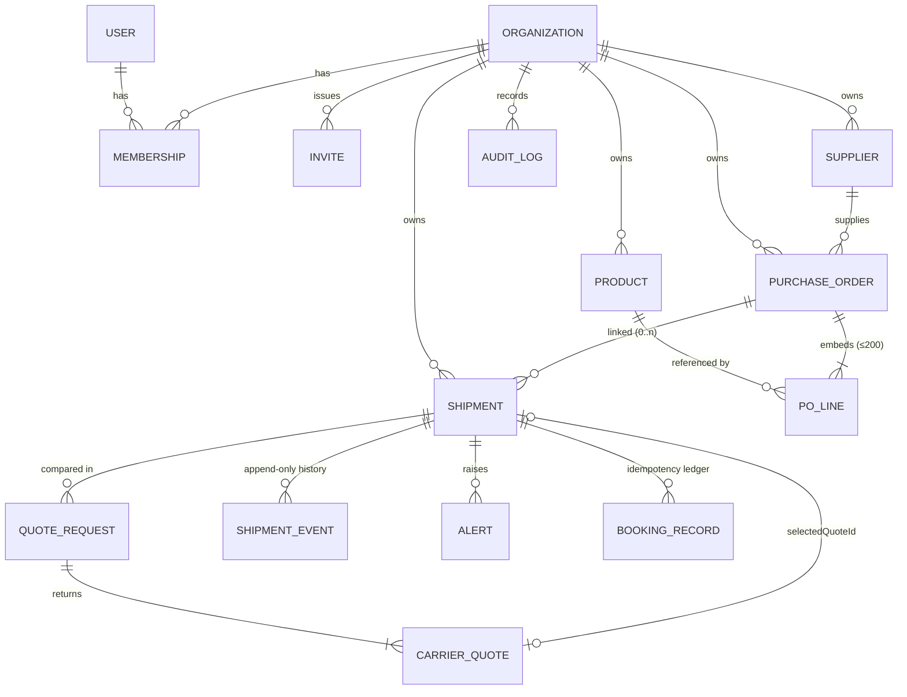

# Data model

MongoDB via Mongoose 9. All organisation-owned documents carry `organizationId`; it leads every compound index. Money is stored as **integer minor units** (`*Minor`), and timestamps are UTC.

## Collections

| Collection | Purpose | Key fields | Indexes |
| --- | --- | --- | --- |
| `users` | People (Google or email sign-in) | `googleSub`, `email`, `name`, `lastOrganizationId`, `isDemoUser` (fictional seed user) | `email` unique; `googleSub` unique (partial) |
| `magiclinktokens` | One-time email sign-in links | `email`, `tokenHash` (SHA-256), `expiresAt`, `usedAt` | `tokenHash` unique; TTL on `expiresAt` |
| `organizations` | Tenants + settings | `name`, `slug`, `settings` (currency, volumetric divisor, recommendation weights, reliability min samples, exception rules), `isDemo` | `slug` unique |
| `memberships` | User ↔ org with role | `role: ADMIN \| MEMBER` | `{organizationId, userId}` unique |
| `invites` | Pending invitations by email | `email`, `role`, `status` | `{organizationId, email}` unique while `PENDING` |
| `suppliers` | Vendor master data | `supplierRef`, `name`, `email`, `country`, `city`, `isActive` | `{organizationId, supplierRef}` unique |
| `products` | Reference catalogue | `sku`, `unitOfMeasure`, `defaultUnitCostMinor`, `currency`, `isActive` | `{organizationId, sku}` unique |
| `purchaseorders` | Purchase orders | `poNumber`, `supplierId`, `lines[]` (qty, unit price, line total, received qty), totals, `status`, `receipts[]` | `{organizationId, poNumber}` unique; `{organizationId, status, orderDate}`; `{organizationId, supplierId, orderDate}`. Optimistic concurrency (`__v`). |
| `shipments` | Movements | route, package spec, weights, requirements, selected offer snapshot, `booking`, `trackingNumber`, `trackingMode`, `status`, `statusChangedAt`, `expectedDeliveryDate`, `pickedUpAt`, `deliveredAt`, `purchaseOrderId` | `{organizationId, reference}` unique; `{organizationId, status, updatedAt}`; `{organizationId, carrierCode, status}`; `{organizationId, purchaseOrderId}`; `{organizationId, expectedDeliveryDate}`; `trackingNumber` |
| `quoterequests` | One comparison run + per-provider outcome | `request` (normalised spec), `providers[]` | `{organizationId, shipmentId, createdAt}` |
| `carrierquotes` | Individual offers (immutable) | price, transit, ETA, `provenance`, `eligibility`, `reliability` snapshot | `{organizationId, quoteRequestId}`; `{organizationId, shipmentId, createdAt}` |
| `bookingrecords` | Booking idempotency ledger | `idempotencyKey`, `status: PENDING \| SUCCEEDED \| FAILED`, result or error | `{organizationId, idempotencyKey}` unique |
| `shipmentevents` | **Append-only** event history | `type`, `occurredAt`, `recordedAt`, `location`, `previousStatus`, `newStatus`, `source {type, provider, isSimulated, sandbox}`, `externalEventId` | `{organizationId, shipmentId, occurredAt}`; `{shipmentId, externalEventId}` unique (partial) — dedupes repeated polls |
| `alerts` | Exceptions | `type`, `severity`, `message`, `recommendedAction`, `status`, `dedupeKey`, `openKey` | `{organizationId, openKey}` unique (partial — only unresolved) ; `{organizationId, status, detectedAt}` |
| `auditlogs` | **Append-only** activity log | `entityType`, `entityId`, `action`, `summary`, actor | `{organizationId, entityType, entityId, createdAt}` |
| `counters` | Per-org sequences for references | `key` (`PO-2026`), `seq` | `{organizationId, key}` unique |
| `sessions` | express-session store (connect-mongo) | TTL index | native TTL |

## Design notes

* **Unbounded histories are never embedded.** Tracking events and audit entries are separate documents; only small bounded arrays (PO lines ≤ 200, receipts, shipment items ≤ 200) are embedded.
* **Append-only enforcement.** `shipmentevents` and `auditlogs` register Mongoose pre-hooks that throw on update/delete operations.
* **Referential checks** happen in services (e.g. a PO's supplier and products must belong to the same organisation and be active; a shipment can only select a quote requested for it; PO cancellation is blocked while linked shipments are active).
* **Status enums** are declared once (`*.rules.ts`) and used for schema `enum` validation, Zod validation and transition tables.
* **Selected offers are copied onto the shipment** (carrier, service, price, source) so shipments remain meaningful after quotes expire.
